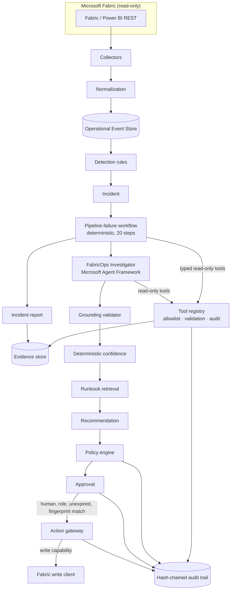

# Orqentis FabricOps

**An AI reliability engineer for Microsoft Fabric estates.** MVP v0.1 · Python 3.12+

Orqentis FabricOps is an operational system, not a chatbot. It observes a Fabric estate, detects
incidents with deterministic rules, collects evidence through typed read-only tools, maps
dependencies and blast radius across workspaces and environments, and has an investigator agent
(Microsoft Agent Framework) reason over that evidence. It then retrieves the matching
version-controlled runbook and recommends remediation behind a policy and approval boundary. Every
step is recorded as an auditable incident.

The MVP is **read-only by default**. No Fabric resource can change unless the mutation passes the
policy engine, a human with the required role approves that exact action, and the deployment has
the write capability enabled.

```
make demo
```

This runs the complete synthetic incident from the spec. It needs no Fabric tenant, Azure
subscription or LLM credentials.

---

## What the demo shows

Scenario: at 06:02 the pipeline `ingest_sales_prod` fails in `transform_sales` because
`expected column "customer_id" is missing`. The upstream CRM feed renamed the column, and
`sales_gold` must be available before 06:30 (Australia/Sydney).

```
1.  Simulated telemetry loaded    18 events (1 ACTIVITY_RUN_FAILED, 4 CAPACITY_METRIC, 1 PIPELINE_RUN_FAILED, ...)
2.  Incident detected             INC-2026-0042 · Pipeline ingest_sales_prod failed · HIGH · PROD
3.  Evidence collected            19 evidence items from 17 read-only tool calls (logged, audited, traced)
4.  Investigation executed        FabricOpsInvestigator (rule_based): 7 findings accepted, 0 rejected
                                  Root cause SCHEMA_DRIFT · confidence HIGH (0.95)
                                  Upstream schema change: column 'customer_id' was removed from sales_orders_raw
                                  in SalesBronze at 2026-10-05 06:01 AEDT and 'client_id' was added, consistent
                                  with a rename. transform_sales still expects the original column and failed.
5.  Dependency impact calculated  6 downstream asset(s) across 2 workspace(s): SalesGold, SalesSemanticModel,
                                  sales_gold, ExecutiveSalesReport, FinanceSemanticModel, MonthEndCloseReport
                                  · cross-workspace
                                  SLA: sales_gold AT_RISK
6.  Runbook matched               RB-SCHEMA-DRIFT-001 v1.3.0 'Upstream schema drift breaks a pipeline
                                  transformation' (score 0.93)
7.  Recommendation produced       Risk MEDIUM_RISK · approval required: yes · incident AWAITING_APPROVAL
                                  · Update the notebook schema mapping [transform_sales] -> MEDIUM_RISK, REQUIRE_APPROVAL
                                  · Rerun the pipeline [ingest_sales_prod] -> LOW_RISK, REQUIRE_APPROVAL
8.  Incident report rendered      var/demo/evidence/INC-2026-0042/report.md
9.  Audit trace persisted         var/demo/audit/audit.jsonl · 28 records · hash chain valid

Approval boundary check (the agent attempts mutations directly)
  - Agent calls request_pipeline_rerun -> ACTION_REQUIRES_APPROVAL (approval APR-…; executed=False)
  - Agent tries to execute APR-… -> BLOCKED PRINCIPAL_NOT_HUMAN
  - Agent requests DELETE_ITEM -> ACTION_DENIED (POL-001-deny-delete)
  - Agent calls a non-allowlisted tool approve_action -> NOT_ALLOWED
  - Write client calls: 0
```

The full incident report is printed afterwards. Every statement in it is labelled **FACT**,
**INFERENCE** or **RECOMMENDATION** and cites evidence ids. Three more scenarios run with
`make demo-all` or `make demo SCENARIO=<name>`:

| Scenario | What FabricOps concludes |
|---|---|
| `schema_drift` | Upstream schema change (rename). Code change ruled out from deployment history, capacity ruled out. Cross-workspace blast radius. Similar to INC-2026-0041. |
| `auth_failure` | The service principal client secret expired 14h before the failure. The secret embedded in the Fabric error is redacted everywhere. Recurrence of INC-2026-0012. |
| `capacity_pressure` | PROD F64 saturated (117% CU, background rejection). The contending workload is a DEV notebook on the PROD capacity. Failure on 3 consecutive Mondays between 05:51 and 06:04. |
| `unknown_failure` | Root cause undetermined, LOW confidence. The recent deployment is surfaced as a possible factor without being asserted as the cause. Read-only escalation; no change proposed. |

## Architecture



Detection, evidence, reasoning, decision and action are kept separate:

* **The LLM never monitors.** Collectors and detection rules are deterministic code.
* **The agent reasons over evidence and nothing else.** A finding is accepted only if it cites
  evidence ids that exist. Fabricated ids, invented runbooks and uncited root causes are rejected
  and recorded on the agent decision.
* **Confidence is computed, not asked for.** It is a weighted combination of error signature,
  runbook, history, dependency, temporal and corroboration signals. Every factor is stored.
* **Policy and approval live outside the LLM.** Mutation tools return `ACTION_REQUIRES_APPROVAL`
  or `ACTION_DENIED` and never execute. Only a human with the required role can approve. Execution
  re-checks the approval, its expiry, the action fingerprint, the policy and the write capability.
* **Fabric metadata is untrusted input.** It is sanitised, scanned for instruction-like content and
  passed to the model inside an explicit untrusted-data envelope.

See [docs/architecture.md](docs/architecture.md) for the full design and the ADRs in
[docs/adr](docs/adr).

## Quick start

```bash
make demo                         # schema-drift incident end to end (creates .venv on first run)
make demo SCENARIO=capacity_pressure
make test                         # unit, integration, scenario and security tests
make check                        # ruff, ruff format, mypy --strict, tests, runbook validation
make serve                        # REST API on http://127.0.0.1:8000, OpenAPI UI at /docs
```

On a machine where `python3` is older than 3.12, use `make demo PYTHON=python3.12`.

### REST API

| Method | Path | Purpose |
|---|---|---|
| GET | `/health` | Liveness and mode |
| GET | `/incidents` | List incidents (`?status=`) |
| GET | `/incidents/{id}` | Full incident: evidence, findings, root causes, blast radius, timeline |
| POST | `/incidents/{id}/investigate` | Run the investigation workflow |
| GET | `/incidents/{id}/evidence` | Evidence |
| GET | `/incidents/{id}/recommendations` | Recommendations with policy decisions |
| GET | `/incidents/{id}/report` | Incident report (`?format=markdown`) |
| GET | `/runbooks`, `/runbooks/{id}` | Runbook catalog |
| GET | `/estate/workspaces` | Workspaces |
| GET | `/estate/items/{id}/dependencies` | Upstream, downstream and blast radius |
| GET | `/approvals` | Approval requests (`?incident_id=&status=`) |
| POST | `/approvals/{id}/approve` · `/reject` | Human decision (role-checked, never the requester or an agent) |
| POST | `/approvals/{id}/execute` | Execute an approved action (refused while the write capability is closed) |
| POST | `/telemetry/collect` | Run collectors and detection |
| GET | `/audit`, `/audit/verify` | Audit trail and hash-chain verification |

Locally, identify yourself with headers: `X-Orqentis-User: you@contoso.com` and
`X-Orqentis-Roles: FabricOps.Operator`. In deployed environments the API uses Microsoft Entra ID
through Container Apps built-in authentication (`ORQENTIS_API_AUTH_MODE=easy_auth`).

### Using the LLM investigator

The deterministic reasoner is the default, so the demo and the tests run offline. To reason with
Azure OpenAI through Microsoft Agent Framework, set:

```bash
ORQENTIS_REASONER=agent_framework
ORQENTIS_AZURE_OPENAI_ENDPOINT=https://<resource>.openai.azure.com
ORQENTIS_AZURE_OPENAI_DEPLOYMENT=<deployment>
```

Authentication uses Microsoft Entra ID (`DefaultAzureCredential`); no API keys are involved. The
agent gets the same allowlisted tools, and its output passes the same grounding validation,
confidence model and policy boundary. If the model fails or returns invalid output, the
deterministic reasoner takes over, and the decision records the fallback.

### Connecting to a real Fabric tenant (read-only)

```bash
ORQENTIS_FABRIC_MODE=rest
ORQENTIS_CONTRACTS_PATH=contracts/estate.json   # declared sources, dependencies, data products, SLAs
ORQENTIS_AUTH_MODE=managed_identity             # or default / workload_identity / service_principal
```

The operating identity needs read permissions only (see [docs/security.md](docs/security.md)).
Fabric has no public API for capacity utilisation or Delta schema history, so those signals arrive
through the event store; in mock mode they are replayed from fixtures.

## Status

| Milestone | Status |
|---|---|
| 1. Domain model + synthetic Fabric estate | Done |
| 2. Incident + evidence model | Done |
| 3. Dependency graph + blast radius | Done |
| 4. Runbook retrieval | Done |
| 5. FabricOps Investigator agent (Agent Framework + deterministic reasoner) | Done |
| 6. Policy and approval boundary | Done |
| 7. REST API | Done |
| 8. Real Fabric read-only adapter | Done (HTTP behaviour covered by tests against mocked transports; not yet run against a live tenant) |
| 9. Eventhouse persistence | Next. `EventStore` port is defined; `LocalEventStore` (SQLite) implemented |
| 10. Teams integration | Planned. `ApprovalProvider` port is defined; `LocalApprovalProvider` implemented |

Definition of done (spec §32):

- [x] repository installs locally · [x] tests pass · [x] synthetic Fabric estate loads
- [x] synthetic failed pipeline creates incident · [x] evidence collector retrieves failure evidence
- [x] dependency graph calculates blast radius · [x] previous incidents are searched
- [x] applicable runbook is retrieved · [x] agent produces evidence-grounded diagnosis
- [x] remediation recommendation is generated · [x] policy engine blocks unapproved mutations
- [x] incident report is persisted · [x] audit trail exists · [x] REST API exposes incident
- [x] local demo runs with one command · [x] Azure/Fabric adapters have clearly defined interfaces
- [x] README explains architecture and demo

## Repository layout

```
src/orqentis/
  domain/         typed models (incident, evidence, findings, actions, approvals, SLA, ...)
  fabric/         FabricClient ports, MockFabricClient, read-only REST adapter, write-capability clients
  telemetry/      collectors and normalisation into operational events
  incidents/      detection, lifecycle, classification, history, confidence, SLA, workflows
  evidence/       evidence recorder
  topology/       estate catalog and storage-agnostic dependency graph
  agents/         FabricOps Investigator, reasoners, prompts, grounding validation
  tools/          tool registry, read-only tools, approval-only mutation tools, untrusted-content handling
  runbooks/       runbook loader and catalog
  policies/       policy engine and default policy (YAML)
  approvals/      approval provider port, local provider, approval rules
  actions/        action gateway (the only path to a mutation)
  storage/        SQLite event store, incident repository, evidence store, dependency store
  reports/        incident report model, builder and Markdown renderer
  api/            FastAPI application
  config/         settings and clock
  observability/  structured logging, OpenTelemetry, redaction, audit trail
runbooks/         version-controlled Markdown/YAML runbooks
fixtures/         synthetic estate, scenario telemetry, incident history
tests/            unit, integration, scenarios (incl. critical security tests)
docs/             architecture, security, product, threat model, development, ADRs
infra/bicep/      Azure deployment (Container Apps, managed identities, App Insights)
```

## Documentation

* [Product](docs/product.md): positioning, persona, scenarios, roadmap
* [Architecture](docs/architecture.md): flow, ports and adapters, workflow, agent, data model
* [Security](docs/security.md): identities, capability boundaries, approval, audit, prompt injection
* [Threat model](docs/threat-model.md): STRIDE analysis and residual risks
* [Development](docs/development.md): setup, configuration, extending runbooks, signatures, scenarios
* [ADRs](docs/adr): recorded architecture decisions

## Licence

Proprietary. See [LICENSE](LICENSE).
