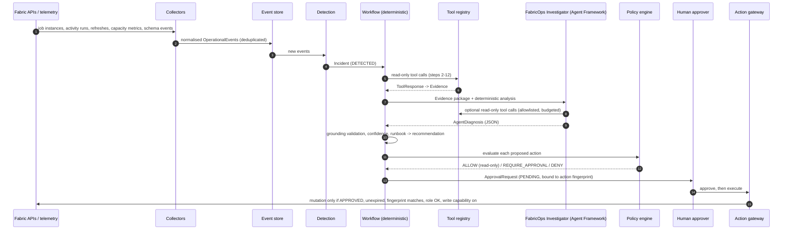
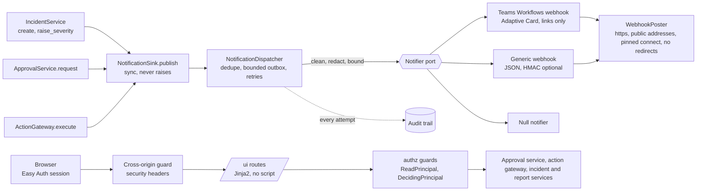

# Architecture

Orqentis FabricOps is a modular monolith in Python 3.12 built on ports and adapters. Domain logic
depends on interfaces (Python `Protocol`s). Azure, Fabric, LLM and storage SDKs appear only in
adapters and in the composition root (`orqentis.bootstrap`).

## 1. Principles

| Principle | How it is enforced |
|---|---|
| Separate detection, evidence, reasoning, decision and action | Separate packages and objects: collectors and detection rules (`telemetry`, `incidents.detection`), evidence recorder (`evidence`), investigator (`agents`), policy and approvals (`policies`, `approvals`), action gateway (`actions`). |
| The LLM is never the monitoring system | Incidents are opened only by deterministic `DetectionRule`s over normalised events. The agent runs only inside an investigation of an existing incident. |
| Reason from evidence, never invent | `Finding.evidence_ids` must be non-empty (model validation). `GroundingValidator` rejects any output citing evidence that is not on the incident, an unknown category or a runbook that was not retrieved. |
| Deterministic confidence | `ConfidenceCalculator` computes a weighted score from observable signals and stores every factor. The model is never asked for a number. |
| Read-only by default | `FabricClient` (read) and `FabricWriteClient` (write) are different ports. Only the `ActionGateway` holds a write client, and the default is `DisabledFabricWriteClient`. |
| Policy outside the LLM | `PolicyEngine` evaluates YAML rules in code. The agent cannot read or modify it, and a code-level invariant forbids auto-allowing any mutation in the MVP. |
| Auditable | Every tool call, policy decision, approval decision, state transition, agent decision and execution attempt is appended to a hash-chained audit log. Evidence artefacts and investigation traces are stored immutably. |

## 2. Flow

## 3. Ports and adapters

| Port (protocol) | Module | MVP adapter | Target adapter | Status |
|---|---|---|---|---|
| `FabricClient` + services (Workspace, Item, Job, Pipeline, SemanticModel, Capacity, Deployment, Dependency) | `fabric.ports` | `MockFabricClient` (synthetic estate) | `RestFabricClient` (Fabric + Power BI REST, read-only) | Both implemented |
| `FabricWriteClient` | `fabric.ports` | `DisabledFabricWriteClient` (default), `MockFabricWriteClient` | REST write adapter | Write adapter deliberately not built (MVP is read-only) |
| `TokenProvider` | `fabric.rest.auth` | `AzureIdentityTokenProvider` over `DefaultAzureCredential` / managed / workload identity / environment, with the configured authority host and scopes (sovereign clouds) | same | Implemented |
| `LineageScanner` | `contracts.lineage` | none in the runtime | `PowerBiScanner` (Power BI admin Scanner API), used only by `orqentis contracts scaffold --scanner` under an interactive administrator sign-in | Implemented (CLI only) |
| `EventStore` | `storage.event_store` | `LocalEventStore` (SQLite) | `PostgresEventStore` (the system of record, ADR-0008/0017). Appends are serialised with an advisory lock so `read_after` returns a gap-free, committed prefix (ADR-0013 §7) | Both implemented |
| `EvidenceStore` | `storage.evidence_store` | `LocalEvidenceStore` (filesystem, immutable) | `BlobEvidenceStore` (Blob API, Entra auth, write-once, version-level immutability; OneLake by URL) | Both implemented |
| `IncidentRepository` | `storage.incidents` | `SqliteIncidentRepository` | `PostgresIncidentRepository` (incident numbers from a counter row) | Both implemented |
| `DependencyStore` | `topology.graph` | `SqliteDependencyStore`, `InMemoryDependencyStore` | `PostgresDependencyStore` | Implemented |
| `ApprovalProvider` | `approvals.provider` | `LocalApprovalProvider` (SQLite, API-driven) | `PostgresApprovalProvider` (compare-and-set on `revision`); `TeamsApprovalProvider` (Adaptive Cards) later | Both implemented; Teams is milestone 10 |
| `Notifier` (behind `NotificationSink` and the dispatcher) | `notifications.port` | `TeamsWorkflowsNotifier`, `GenericWebhookNotifier`, `NullNotifier` | the same, plus a durable outbox on the PostgreSQL storage | Implemented (ADR-0018) |
| `AuditTrail` | `observability.audit` | `LocalAuditLog` (hash-chained JSONL) | `PostgresAuditTrail` (chain head row `FOR UPDATE`; head anchored to immutable blobs through `AuditAnchorStore`) | Both implemented |
| `Reasoner` | `agents.reasoning` | `RuleBasedReasoner` | `AgentFrameworkReasoner` (Azure OpenAI or Foundry via Microsoft Agent Framework) | Both implemented |
| `LeaderLease` | `runtime.lease` | `InProcessLeaderLease` (single process) | `PostgresLeaderLease` (database clock, fencing generation; fenced writes in `runtime.fencing`) | Both implemented |
| `JobStore` | `runtime.job_store` | `InMemoryJobStore` | `PostgresJobStore` (unique active job per incident, `FOR UPDATE SKIP LOCKED` claims, heartbeats) | Both implemented |
| `Mutex` | `runtime.mutex` | `InProcessMutex` | `PostgresMutex` (advisory lock on a dedicated connection) | Both implemented |
| `AuditAnchorStore` | `observability.anchors` | `LocalAuditAnchorStore` | `BlobAuditAnchorStore` (write-once blobs in an immutable container) | Both implemented |
| `Collector` | `telemetry.collectors` | pipeline runs, refreshes, capacity, static replay | Eventhouse-backed capacity / schema collectors | Implemented for REST-available data |
| `DetectionRule` | `incidents.detection` | `PipelineFailureRule` | more rules per secondary scenario | Implemented for the primary scenario |
| `InvestigationWorkflow` | `incidents.workflows.base` | `PipelineFailureWorkflow` | refresh failure, SLA, drift workflows | Implemented for the primary scenario |

### Declared contracts and environments

What Fabric cannot tell FabricOps is declared in a version-controlled **contracts file** (`contracts/`,
schema in `schemas/contracts.schema.json`, ADR-0014): environments, external sources, data products,
dependencies and SLAs. `load_contracts` validates it and raises a typed `ContractsError` that names the
path and every violation; `orqentis contracts validate | scaffold | schema` author and check it
offline. The **environment** of a workspace is its declaration (by id, then by name pattern) or, failing
that, an inference from its name (`topology/environment.py`); items inherit it unless declared. The REST
adapter resolves it once, so detection severity and the policy engine see the same value. Scaffold drafts a
contracts file through the read-only `FabricClient` port; the draft is reviewed and never applied
automatically.

Where the file comes from depends on the storage backend (ADR-0017 section 12): `ORQENTIS_CONTRACTS_PATH` (a file) for
local and mock runs, otherwise, in a deployed environment, the `contracts/estate.json` **blob** that a person uploads and
the app can only read (`ContractsSource` in `contracts/source.py`; the Blob implementation is in the Blob adapter
package). The catalog refresh re-reads it on every replica: an unchanged SHA-256 is a no-op, a changed one is validated,
applied in place and audited (`contracts.loaded` with the SHA-256 and blob version), and an invalid or missing one raises
the typed error while the last good contracts stay in force. At start-up a missing or invalid blob leaves the app not
ready (`/health/ready` 503, `build_failed`), retried with backoff, never a crash loop.

## 4. Domain model

All models are Pydantic v2 with `extra="forbid"` (`orqentis.domain`). The core models:

* Estate: `Tenant`, `Capacity`, `Workspace`, `FabricItem` (a discriminated union of `Pipeline`,
  `Notebook`, `Lakehouse`, `Warehouse`, `SemanticModel`, `Report`, `ExternalSource`, `GenericItem`)
  and `DataProduct`.
* Execution: `PipelineRun`, `ActivityRun`, `Refresh`, `CapacitySnapshot`.
* Topology and events: `Dependency` (edges `TRIGGERS`, `READS_FROM`, `WRITES_TO`, `REFRESHES`,
  `DEPENDS_ON`, `PRODUCES`, `CONSUMES`, each with a defined flow direction) and `OperationalEvent`.
* Incident: the `Incident` aggregate, `Evidence`, `Finding`, `RootCauseCandidate`, `BlastRadius`,
  `AffectedAsset`, `TimelineEntry`, `RelatedIncidentMatch`.
* Decisions: `Runbook`, `RunbookMatch`, `Recommendation`, `Action`, `PolicyDecision`,
  `ApprovalRequest`, `AgentDecision`, `ConfidenceAssessment`.
* Contracts: `SLA`, `SLAAssessment`, `DeploymentState`, `DeploymentComparison`.

Incident status is a state machine (`domain.incidents.ALLOWED_TRANSITIONS`). Only
`AWAITING_APPROVAL` may move to `REMEDIATING`, so remediation cannot start without an approval
request. The taxonomy (`domain.taxonomy`) has the 17 built-in categories and a registry for
extensions (`TAXONOMY.register("DBT_TEST_FAILURE")`).

## 5. Investigation workflow (pipeline failure)

`incidents/workflows/pipeline_failure.py` implements the specification's 20 steps. Each step is
timed, traced (OpenTelemetry span `investigation.step.NN`) and recorded in the
`InvestigationTrace`, which is persisted as `trace-<trace_id>.json` beside the evidence.

| # | Step | Evidence produced |
|---|---|---|
| 1 | Start investigation (cancel superseded approvals on re-investigation) | (none) |
| 2 | Fetch pipeline run (`get_pipeline_run`) | PIPELINE_FAILURE |
| 3 | Fetch activity runs (`get_pipeline_activity_runs`); failure points = targets of failed activities | ACTIVITY_FAILURE |
| 4 | Capture error evidence and classify by error signature | ERROR_MESSAGE (with signature match) |
| 5 | Resolve pipeline and workspace metadata | ITEM_METADATA, WORKSPACE_METADATA |
| 6 | Upstream traversal, declared sources (credential expiry), schema-change events | DEPENDENCY_EDGE, ITEM_METADATA, SCHEMA_CHANGE |
| 7 | Downstream traversal and blast radius (skipped-activity targets count as direct impact) | DEPENDENCY_EDGE, BLAST_RADIUS |
| 8 | Refresh history of affected semantic models | SEMANTIC_MODEL_REFRESH |
| 9 | Data product SLA evaluation (raises severity to CRITICAL on breach) | SLA_STATUS |
| 10 | Capacity context around the failure, contending workloads | CAPACITY_METRIC |
| 11 | Related incidents, recurring pattern, deployment comparison | HISTORICAL_INCIDENT, DEPLOYMENT_COMPARISON |
| 12 | Runbook retrieval | RUNBOOK_MATCH |
| 13 | Build the evidence package | (none) |
| 14 | FabricOps Investigator generates findings (may call read-only tools) | agent tool results |
| 15 | Candidate root cause (grounded) | (none) |
| 16 | Deterministic confidence | (none) |
| 17 | Recommendation from the runbook's remediation actions | (none) |
| 18 | Policy evaluation; approval requests opened through the `ActionGateway` | (none) |
| 19 | Persist (DIAGNOSED, then AWAITING_APPROVAL when approvals are pending) | (none) |
| 20 | Render the incident report (Markdown + JSON) | report.md, report.json |

A tool failure does not abort the investigation. It is recorded in the trace, and the missing
evidence lowers confidence. An unexpected exception returns the incident from INVESTIGATING to
DETECTED and is audited.

## 6. The FabricOps Investigator

* `FabricOpsInvestigator` (`agents/investigator.py`) runs a `Reasoner` with an `AgentToolbox`.
  The toolbox enforces the policy's tool allowlist, a call budget and automatic evidence recording
  for every successful read.
* `AgentFrameworkReasoner` (`agents/agent_framework.py`) builds a Microsoft Agent Framework
  `Agent` with versioned system instructions (`agents/prompts.py`). Each `ToolSpec` becomes a
  `FunctionTool` whose JSON schema is the tool's Pydantic input model. The agent's answer must be
  an `AgentDiagnosis` JSON object. Chat clients use Entra ID credentials: Azure OpenAI through
  `OpenAIChatClient(azure_endpoint=…, credential=…)`, or `FoundryChatClient`.
* `RuleBasedReasoner` (`agents/rule_based.py`) is deterministic and evidence-cited. It drives
  the demo and the tests, and acts as the fallback when the LLM path fails. Any fallback is
  recorded on the `AgentDecision`.
* `GroundingValidator` accepts only output backed by evidence. Rejected outputs and the reason
  for each are stored on the `AgentDecision`, together with the prompt version, model, token usage
  and tool-call ids.

Plain async Python orchestrates around the agent; Agent Framework workflows are not used there
(see [ADR-0002](adr/0002-deterministic-orchestration-around-the-agent.md)).

## 7. Tools

Every tool is a `ToolSpec` with a Pydantic input model (`extra="forbid"`, constrained ids) and an
async handler returning a `ToolOutcome`. `ToolRegistry.invoke` performs these steps in order:

1. Check the budget, then the allowlist (the agent context only).
2. Validate the input.
3. Run the handler under a timeout and an OpenTelemetry span.
4. Map errors (`NOT_FOUND`, `ERROR`, `TIMEOUT`).
5. Redact secrets.
6. Return a `ToolResponse` with `tool_call_id`, `timestamp`, `source`, `status`, `data`, `errors`
   and `metadata` (latency, trace id, caller).
7. Append a `ToolCallRecord` and write an audit record.

Read tools: `get_pipeline_run`, `get_pipeline_activity_runs`, `get_item`, `get_workspace`,
`get_upstream_dependencies`, `get_downstream_dependencies`, `get_semantic_model_refresh_history`,
`get_capacity_context`, `get_recent_related_incidents`, `search_runbooks`, `get_deployment_state`,
`get_sla`, `get_operational_events`.

Mutation-request tools: `request_pipeline_rerun`, `request_semantic_model_refresh` and
`request_item_change`. They only call `ActionGateway.submit` and return
`ACTION_REQUIRES_APPROVAL` or `ACTION_DENIED`.

## 8. Dependency graph

`topology/graph.py` builds adjacency lists from `Dependency` edges and normalises each edge into
an (upstream, downstream) pair from its type. It provides `get_upstream`, `get_downstream`,
`get_blast_radius` and `find_path`. Traversal is breadth-first and cycle-safe (lakehouse to
notebook to the same lakehouse is common), and returns depth and path. Edges are persisted in a
relational table (`storage/dependency_store.py`). No graph database is used; see
[ADR-0004](adr/0004-relational-dependency-graph.md).

Fabric has no general lineage REST API, so dependencies are **declared** contracts kept under
version control alongside data products and SLAs (`ORQENTIS_CONTRACTS_PATH`). The scanner/admin
lineage APIs can feed the same port later.

## 9. Confidence model

`incidents/confidence.py` defines version `orqentis-weighted-signals-v1`:

| Factor | Weight | Value |
|---|---|---|
| error_signature_match | 0.25 | 1.0 if the error signature category equals the root cause category, 0.5 if it maps elsewhere |
| runbook_match | 0.15 | Score of the selected runbook when its category matches |
| historical_incident_match | 0.15 | Highest similarity of a previous incident in the same category |
| dependency_correlation | 0.15 | 1.0 if root-cause evidence is on an item upstream of the failure point, 0.5 if on the shared capacity |
| temporal_correlation | 0.15 | 1.0 if causal evidence precedes the failure within 24h |
| corroborating_sources | 0.15 | Distinct evidence sources cited by the root cause (3 or more = 1.0) |

The score is capped at 0.95. Levels are HIGH (0.75 and above), MEDIUM (0.45 and above) and LOW.

## 10. Policy, approval and action

* `policies/default_policy.yaml` holds the risk classification per action type, ordered roles,
  rules and the agent tool allowlist. Precedence is DENY > REQUIRE_APPROVAL > ALLOW > default
  (DENY). Unclassified action types are treated as HIGH_RISK, and a code-level invariant turns
  any ALLOW of a mutation into REQUIRE_APPROVAL.
* `ApprovalService` refuses decisions from non-human principals, from the requester, from anyone
  without the required role, after expiry, and on any approval that is no longer PENDING.
* `ActionGateway.execute` runs a mutation only when the approval is APPROVED and unexpired, the
  action fingerprint (SHA-256 of type, target, workspace, environment and parameters) still
  matches, the principal is a human with the role, the action has not already run, the policy
  does not now deny it, and the write capability is enabled. Every refusal is audited.

## 11. Observability

* Structured JSON logs (`observability/logging.py`), with `trace_id` and `incident_id` from
  context variables and secrets redacted.
* OpenTelemetry spans for investigations, steps, tools and the agent. With
  `APPLICATIONINSIGHTS_CONNECTION_STRING` set and the `azure-monitor` extra installed, telemetry
  exports to Application Insights through the Azure Monitor distro. Agent Framework's own chat
  telemetry layer emits GenAI spans with token usage.
* Each investigation trace records step latency, every tool call (caller, latency, status), the
  agent decision (model, prompt version, token usage, rejected outputs), policy decisions and
  approval ids.

## 12. Extending

| To add | Do this |
|---|---|
| A runbook | Add Markdown with front matter under `runbooks/`. The loader validates required keys and sections, and `orqentis runbooks` lints the catalog. |
| An error signature | Register an `ErrorSignature` (regex patterns, entity extraction, priority) mapped to a taxonomy category. |
| An incident category | `TAXONOMY.register("NAME")` at start-up. |
| A detection rule | Implement `DetectionRule.evaluate(event) -> IncidentCandidate | None` and add it to `DetectionEngine`. |
| An investigation workflow | Implement `InvestigationWorkflow` (`supports`, `run`) and register it in `bootstrap.py`. |
| A storage backend | Implement the port and wire it in `bootstrap.py`; domain code is unchanged. |
| A scheduled job | Add a `JobSpec` (name, interval, async function) in `bootstrap.py` and a `scheduler_<name>_*` setting pair (enabled, interval). |

## 13. Autonomous runtime

FabricOps works without being called. Everything below lives in `orqentis.runtime` and is wired in
`bootstrap.py`; the investigation workflow itself is unchanged.

**Process lifecycle** (`api/app.py`, `runtime/service.py`). The FastAPI lifespan starts a `Runtime`
that builds the container in the background and returns within `ORQENTIS_STARTUP_GRACE_SECONDS`, so
the port opens even when reading the estate takes minutes. `GET /health` is liveness (no
dependencies, always `200` while the process runs). `GET /health/ready` is `503` with a fixed
reason code and the exception type (never its message: the probe is unauthenticated) until the container is built and the first catalog load finished. If the build
raises (invalid contracts, Fabric unreachable, anything), the exception is logged, the process
stays up, and the build is retried with exponential backoff (`ORQENTIS_BUILD_RETRY_*`); resources
opened by a failed attempt are closed. Other endpoints answer `503 NOT_READY` meanwhile.

**Scheduler** (`runtime/scheduler.py`). Jobs are `JobSpec(name, interval, async function)`. Every
tick (`ORQENTIS_SCHEDULER_TICK_SECONDS`) the scheduler acquires or, once a third of the TTL is left,
renews a `LeaderLease` (TTL >= 3 x tick); only the holder starts jobs, each with a `JobContext` (holder
and fencing token), and a holder that loses the lease cancels its running jobs. A job never
overlaps with itself: a run that outlasts its interval makes the next slot be skipped (counted),
not queued, and missed slots collapse into one run. A job that raises or times out is logged and
recorded in `Scheduler.status()`; it is audited when its health *changes* (first failure,
recovery), and never stops the scheduler or other jobs. The scheduler reads time from the injected
`Clock`, so tests drive it with a fake clock.

| Job | Default | What it does |
|---|---|---|
| `collect-detect` | every 5 min | `TelemetryIngestor` then `DetectionEngine` (serialised with `POST /telemetry/collect`) |
| `auto-investigate` | every 1 min | submits an investigation job for each `DETECTED` incident not already being investigated (most severe first, bounded per run and per incident) |
| `sla-sweep` | every 15 min | assesses every declared SLA and appends an `SLA_ASSESSED` event when an SLA enters a new state for a deadline day |
| `catalog-refresh` | every 60 min | reloads workspaces, items, capacities and declared dependencies, applies the diff to the live catalog and graph, audits it |

**Investigation jobs** (`runtime/investigations.py`). `POST /incidents/{id}/investigate` returns
`202` with a job; the scheduler submits through the same runner, so there is one code path.
Submitting while a job for the incident is queued or running returns that job (idempotent per
incident). At most `ORQENTIS_INVESTIGATION_MAX_CONCURRENCY` run at once, each with a timeout; a job
that times out, is cancelled or fails puts its incident back to `DETECTED`. Auto-investigation gives
up on an incident after `ORQENTIS_SCHEDULER_AUTO_INVESTIGATE_MAX_ATTEMPTS` failures (a human can
still investigate it) and resets incidents orphaned in `INVESTIGATING` by a crashed process.
Automation acts as `system:orqentis`; the agent still cannot approve or execute.

**Incremental collection** (`telemetry/collectors.py`, `storage/event_store.py`). Watermarks live in
the event store, one per collector and, for collectors over many independent things (pipelines,
semantic models, capacities), one per **scope** (the item id). A scope reads
`[watermark - overlap, now]`, never further back than `ORQENTIS_COLLECTION_MAX_LOOKBACK_HOURS`; a
scope with no watermark (a pipeline that appeared through a catalog refresh) reads the full maximum
lookback, so it is not blind before the collector's overall progress, even after a restart. The
watermark advances only after the events were stored, so a failed scope retries the same window and
does not hold back the others. A watermark ahead of the clock is not trusted: it is logged, the
maximum lookback is re-read once and the watermark is corrected. The overlap is safe because events
are de-duplicated by `dedupe_key`. Fabric documents no ordering for "List Item Job Instances", so job
listings filter by the watermark without stopping early and are capped at
`ORQENTIS_FABRIC_JOB_INSTANCES_MAX_PAGES` pages.

**Durable detection** (`incidents/detection_runner.py`). Storing events and detecting from them are
separate steps, and a run can be cut short between them. The event store numbers every inserted
event and keeps a cursor per consumer; `DetectionRunner` reads the events after its cursor, runs the
detection engine and advances the cursor only after the engine returned. `CollectionService` runs it
after collecting and also when collecting is interrupted or fails; the SLA sweep uses the same
runner. Re-reading after an interruption is harmless because the engine de-duplicates by item and
correlation (or by the triggering event).

**Fabric call budget** (`fabric/rest/budget.py`). One semaphore and one token bucket, shared by every
Fabric and Power BI call through `FabricHttp`, cap concurrency and request rate. A `429` or any
`Retry-After` pauses all callers, and retry sleeps never hold a slot.

**Catalog refresh** (`topology/refresh.py`). A new snapshot is built first (any error applies
nothing), an empty estate is refused, and the dictionaries of the live catalog are rebound, so a
collector iterating them is unaffected. The diff (added, removed, changed ids per kind, including
dependencies) is logged and audited.

## 14. Human interface: notifications and the web UI

Implements [ADR-0010](adr/0010-human-interface.md); the choices are in [ADR-0018](adr/0018-notifications-and-web-ui.md).

**Notifications** (`orqentis.notifications`). The domain publishes `NotificationEvent`s after the state change and its audit
record; with no notifier configured the sink discards them. The `NotificationDispatcher` composes a clean message
(`content.py`: sanitised, redacted, length-limited, deep link from `ORQENTIS_PUBLIC_BASE_URL`), de-duplicates by event id, queues it in a
bounded outbox (oldest dropped when full) and one worker delivers it with retries (exponential, jittered, honouring `Retry-After`) and
one audit record per attempt. Adapters implement `Notifier.send`: `TeamsWorkflowsNotifier` (an Adaptive Card with a single link and no
action), `GenericWebhookNotifier` (JSON, `X-Orqentis-Signature`) and `NullNotifier`. Both HTTP adapters go through `WebhookPoster`, the
only place that calls a webhook (SSRF guard). `Runtime` starts and stops the dispatcher with the scheduler.

**Web UI** (`orqentis.ui`). `routes.py` holds the pages; each depends on the same guard as the corresponding API route and calls the
same service. `render.py` renders Jinja2 templates with autoescape on and without `|safe`. `security.py` has the cross-origin guard
(every state-changing request) and the response headers (everything under `/ui`); `csrf.py` signs the form tokens; `install.py` mounts the
router, wraps the existing exception handlers so a `/ui` error is an HTML page with the API's status and code, and is called last in
`create_app`. Errors outside `/ui` are unchanged.

| Page | Route | Guard | Notes |
|---|---|---|---|
| Incident list | `GET /ui/incidents?status=&severity=` | `ReadPrincipal` | filters validated against the enums |
| Incident | `GET /ui/incidents/{id}` | `ReadPrincipal` | root cause, approvals, timeline, evidence (payloads escaped) |
| Report | `GET /ui/incidents/{id}/report` | `ReadPrincipal` | the API's report, every statement labelled |
| Approvals | `GET /ui/approvals`, `/ui/approvals/{id}` | `ReadPrincipal` | decision forms only for a person who could use them |
| Decide | `POST /ui/approvals/{id}/approve`, `/reject`, `/execute` | `DecidingPrincipal` | form token + cross-origin guard; `ApprovalService.decide` / `ActionGateway.execute` |
| Audit | `GET /ui/audit` | `VerifyPrincipal` | hash-chain verification and the latest records |

The structural route test (`tests/integration/test_api_identity.py`) walks every route of the live app, including routers that are not
under `orqentis.api.routers`, and fails for a route without authentication, a role guard, or (for a mutation) the human-only guard.

## 15. Storage and replicas

`ORQENTIS_STORAGE_BACKEND` selects one of two compositions of the storage ports (`bootstrap.py`):

| | `local` (development, tests, mock mode, `make demo`) | `postgres` (required in `dev`, `test`, `prod`) |
|---|---|---|
| Events, incidents, dependencies, approvals | SQLite files under `ORQENTIS_DATA_DIR` | PostgreSQL tables (`orqentis.storage.postgres`) |
| Audit trail | hash-chained JSONL file | hash chain in PostgreSQL, head anchored to immutable blobs |
| Evidence and reports | files | Blob storage (`orqentis.storage.blob`), OneLake by URL |
| Leader lease, investigation jobs, mutex | in process | PostgreSQL (database clock, fencing, `SKIP LOCKED`) |
| Replicas | 1 | 2 or more; revisions may overlap during a deploy |

What makes two or more replicas safe ([ADR-0017](adr/0017-postgresql-system-of-record.md)):

* **Event cursor.** Appends take an advisory lock, so the sequence is commit order and `read_after` is a gap-free
  committed prefix. A bare identity column would let a late commit be skipped for good.
* **Approvals.** A decision, an expiry and the execution claim are `UPDATE ... WHERE revision = $n`: one winner.
* **Audit chain.** An append locks the one head row, so no two records share a predecessor. Verification re-derives
  the hashes and compares with the latest anchor in immutable storage.
* **Leader.** The lease compares the database clock; every scheduled job runs under a fence, and each write transaction
  checks it against the lease row (share-locked until commit): a deposed leader's late write is refused.
* **Detection** is check-then-act, so it runs under a mutex across replicas.
* **Investigation jobs** are rows: one active job per incident, claimed with `FOR UPDATE SKIP LOCKED` by any replica,
  kept alive by heartbeats, re-claimed when a worker dies, handed back on a graceful stop.
* **Schema.** Versioned migrations run as the application's role behind an advisory lock at start-up; they stay
  compatible with the previous release because the old revision serves while the new one migrates.

Authentication to PostgreSQL and Blob is Microsoft Entra only (the managed identity's token is the database password);
there is no storage key and no password setting. Backups, point-in-time restore and what happens to evidence and
audit anchors are in [operations/restore.md](operations/restore.md).
